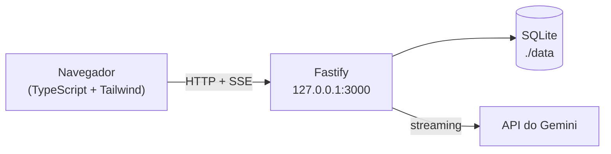

# Chronicler Engine

> [!IMPORTANT]
> **Projeto 100% gerado por IA.** Todo o código, testes, documentação e configuração deste repositório foram produzidos por um agente de IA no **Antigravity**, usando o modelo **Claude Sonnet 5.5 com *thinking* no nível High** (informação fornecida pelo autor do projeto). O papel humano foi o de definir o design document, aprovar as decisões de implementação e revisar o andamento. Trate o código como qualquer código gerado por IA: revise antes de usar em produção.

Plataforma de escrita e RPG narrativo colaborativo: você conduz a história e o Gemini atua como **Narrador**, escrevendo a prosa em um *Tome* (sem balões de chat): cada instrução sua gera uma **página**, e cada página é uma folha separada do livro. Tudo roda localmente, com SQLite — só a geração de texto sai da sua máquina, rumo à API do Gemini.

> [!WARNING]
> **Alpha:** o formato do banco de dados ainda pode mudar. Desde o schema v4 (hoje v5) as atualizações costumam ser **migradas automaticamente** (com cópia de segurança `.bak` ao lado do banco), mas bancos anteriores (v1/v2) e eventuais mudanças futuras caras demais para migrar exigem **apagar a pasta `./data`** (copie suas crônicas antes, com *Salvar em Markdown*). Um banco incompatível é recusado na abertura, com uma mensagem explicando isso.

> Especificação completa e decisões de implementação: [`chronicler_engine_design_document.md`](chronicler_engine_design_document.md) (a seção 11 prevalece em caso de conflito). Andamento: [`TASKS.md`](TASKS.md).

<p align="center">
  
</p>

## Sumário

- [Recursos](#recursos)
- [Requisitos](#requisitos)
- [Subindo com Docker](#subindo-com-docker)
- [Subindo com Podman](#subindo-com-podman)
- [Primeiro uso](#primeiro-uso)
- [Narração por voz](#narração-por-voz)
- [Usar no celular (PWA)](#usar-no-celular-pwa)
- [Atualizar, parar e fazer backup](#atualizar-parar-e-fazer-backup)
- [Solução de problemas](#solução-de-problemas)
- [Capturas de tela](#capturas-de-tela)
- [Como funciona](#como-funciona)
- [Desenvolvimento local](#desenvolvimento-local)
- [Licença](#licença)
- [Sobre a autoria](#sobre-a-autoria)

## Recursos

- **Tela inicial de jogo**: logo em arte ASCII (SVG na paleta [Srcery](https://srcery.sh), que se ajusta a qualquer largura — empilhado em duas linhas no celular), a legenda e o menu **Continuar** / **Nova Crônica** (os dois abrem um quadro sobre o menu, com o fundo escurecido; o botão *Voltar* do navegador fecha o quadro) / **Opções** (página com a conexão com o Gemini e a narração por voz).
- **Tome em páginas**: cada texto gerado por um prompt é uma *página*, numerada (`Página 1`, `Página 2`…, numeração absoluta que não recomeça após compactar) e exibida como uma folha separada. Streaming da narrativa e, no rodapé de cada página, quatro ações em **ícones sempre visíveis** (com tooltip): 🔊 *ouvir a página* (ver [Narração por voz](#narração-por-voz)), ✎ *editar o texto*, 💬 *editar o prompt e re-gerar* (descartando as páginas posteriores, com aviso) e ⑂ *ramificar a partir daquela página*. Nas páginas de diálogo (abaixo), o 💬 vira *Refazer diálogo*, e as que ainda estão como transcrição crua ganham a pena 🪶 *Narrar diálogo*.
- **Narração por voz** (opcional): um narrador de voz grave lê as páginas em português do Brasil (Gemini TTS). O áudio fica guardado no SQLite (ouvir de novo é grátis), é descartado se a página mudar, pode ser gerado de novo ou baixado em MP3, e funciona também nas páginas já coletadas em volumes. Geração automática por crônica, desligada por padrão (para as páginas de diálogo há uma opção própria, também desligada).
- **Modo Diálogo**: o Narrador pode abrir uma conversa com um NPC (persona isolada, que não conhece o resto da história); ele mesmo escolhe o nome do NPC e como você será chamado na cena. Quem encerra é você (`Encerrar diálogo` ou `Descartar`); o NPC apenas *sinaliza* que quer terminar, destacando o botão. **A conversa vira uma página** (selo *Diálogo com …*): o Narrador escreve a prosa em volta das falas, que ficam **literais** (em discurso direto, sem rótulos de falante, o que também evita que a voz leia os nomes). Se ele alterar alguma fala, a página é refeita (até 3 tentativas) e, no pior caso, a conversa é salva como transcrição crua (`**Nome:** fala`), com um aviso. Páginas cruas (e as de diálogo de versões anteriores) podem ser transformadas em prosa com *Narrar diálogo*, sem mexer nas páginas seguintes. A página pode ser editada sem afetar as seguintes. O ícone *Refazer diálogo* abre uma nova conversa com o mesmo NPC **sem apagar nada**: a página antiga (e as seguintes) só são substituídas quando você encerra o novo diálogo; *Descartar* mantém tudo como estava. Recarregar a página retoma a cena.
- **HP do Narrador**: barra de contexto (tokens usados × limite configurável por sessão) e **Compactação de Crônica**, que gera uma sinopse revisável por você antes de transformar as páginas antigas em um *volume*. As páginas consumidas saem do contexto da IA, mas **continuam legíveis** (botão *Ler as N páginas*, em uma tela própria) e exportáveis.
- **4 temas**, cada um em variação clara e escura (Medieval, Cyberpunk, Pós-apocalíptico, Contemporâneo — 8 combinações, todas verificadas em um navegador headless), com fontes empacotadas localmente (nenhum CDN). O modo segue o sistema por padrão.
- **Salvar em Markdown** (`.md`): as páginas saem separadas por `---`. Escolha entre a crônica completa, só o que está no Tome ou só as páginas já em volumes, com a opção de incluir mundo e sinopses; cada volume também pode ser salvo sozinho. Seus prompts nunca vão no arquivo.
- **Seletor de modelos** alimentado pela própria API do Gemini (só modelos de geração de texto), com padrão global e escolha por sessão.
- **Feito para o celular**: no Tome e no leitor de volume a interface cabe exatamente na tela — cabeçalho no topo, campo de digitação embaixo e **só a área das páginas rola**, com a barra do navegador ou o teclado abertos. Botão **Tela cheia** no cabeçalho e **instalável como PWA** (ver [Usar no celular](#usar-no-celular-pwa)).
- Interface em pt-BR, responsiva (funciona no celular) e acessível por teclado (botões de ícone com tooltip e `aria-label`).

## Requisitos

| O que | Para quê |
| --- | --- |
| **Docker** com Compose v2 **ou** **Podman** (+ `podman-compose`) | Subir o contêiner (não é preciso instalar Node na máquina) |
| **Chave da API do Gemini** | Gerar texto. Crie uma em [Google AI Studio](https://aistudio.google.com/apikey); ela é informada pela interface, não por arquivo |
| ~300 MB de disco e acesso à internet no *build* | Baixar a imagem `node:22-alpine` e as dependências |

Em qualquer máquina com Linux, macOS ou Windows (WSL2) que rode contêineres, o fluxo é o mesmo.

## Subindo com Docker

Você pode rodar diretamente puxando a imagem pré-compilada pelo GitHub Actions (não precisa compilar nada no servidor):

```bash
docker run -d --name chronicler-engine --restart unless-stopped \
  -p 127.0.0.1:3000:3000 \
  -v ./data:/data \
  ghcr.io/alghostzx/chronicler-engine:latest
```

Ou usando o repositório com Docker Compose:

```bash
git clone https://github.com/alghostzx/Chronicler-Engine.git chronicler-engine
cd chronicler-engine
# Puxa a imagem pronta do GHCR (instantâneo):
docker compose up -d
# Ou, se preferir compilar localmente:
docker compose up -d --build
```

Abra <http://localhost:3000>. Pronto: o contêiner reinicia sozinho (`restart: unless-stopped`) e os dados ficam em `./data`.

> [!NOTE]
> Se o Docker acusar `permission denied ... docker.sock`, o seu usuário não está no grupo `docker`: rode `sudo usermod -aG docker $USER` e abra uma nova sessão (ou use `newgrp docker`). Se disser que não consegue conectar à API, o serviço está parado: `sudo systemctl enable --now docker`.

Validado com Docker 29 + Compose 5 (Fedora 44): *build*, subida com o volume criado pelo próprio Docker (o *entrypoint* acerta a posse e o servidor roda **sem root**), `healthcheck` *healthy*, dados persistindo após `restart` e parada em < 1 s.

## Subindo com Podman

Rootless (sem `sudo`), inclusive em Fedora/RHEL com SELinux. Há duas formas equivalentes.

**A) Com `podman-compose`** (instale com `pip install --user podman-compose` ou `sudo dnf install podman-compose`):

```bash
git clone https://github.com/alghostzx/Chronicler-Engine.git chronicler-engine
cd chronicler-engine
mkdir -p data
podman-compose -f docker-compose.yml -f docker-compose.podman.yml up -d --build
```

**B) Só com `podman`** (sem compose):

```bash
podman build -t chronicler-engine .
mkdir -p data
podman run -d --name chronicler-engine --restart unless-stopped \
  --userns=keep-id --user "$(id -u):$(id -g)" \
  -p 127.0.0.1:3000:3000 \
  -v ./data:/data:Z \
  chronicler-engine
```

Abra <http://localhost:3000>.

Por que o `docker-compose.podman.yml` e esses parâmetros? Em modo rootless, o "root" do contêiner é o seu usuário. Com `--userns=keep-id` + `--user`, os arquivos de `./data` continuam pertencendo a você; o sufixo `:Z` do volume ajusta o rótulo SELinux (inofensivo onde não há SELinux). O `HEALTHCHECK` do Dockerfile é ignorado no formato OCI do Podman (só aparece um aviso no *build*).

## Primeiro uso

1. No menu inicial, abra **Opções** e informe a chave em *Conexão com o Gemini* (*Validar e salvar*). Enquanto não há chave, o menu avisa e o item *Opções* pulsa. A chave é testada na hora, gravada **apenas** no SQLite local e nunca devolvida ao navegador.
2. Ainda em *Opções*, escolha o **modelo padrão** na lista (ela é consultada na API; *Atualizar* consulta de novo). O padrão inicial é `gemini-3.8-flash`. Volte pelo ícone de seta.
3. Em **Nova Crônica**, dê um título, escolha o tema visual, o limite de tokens do contexto (padrão: 1.000.000) e, se quiser, descreva o mundo e os personagens. Para retomar uma crônica, use **Continuar**.
4. No Tome, descreva o que o seu personagem faz e envie com `Enviar` ou `Ctrl+Enter`. O Narrador responde em prosa, em tempo real.
5. Use o painel **Contexto** (ícone à direita no cabeçalho) para editar mundo/personagens e ler os volumes compactados, **Salvar em Markdown** para exportar, e acompanhe o **HP** na barra inferior: perto de zero, o botão *Compactar Crônica* pulsa.

> [!WARNING]
> A interface **não tem autenticação** e o banco guarda a chave da API. Por isso a porta é publicada somente em `127.0.0.1`. Para acessar de outra máquina, ponha um proxy reverso com autenticação (ou uma VPN) na frente — não troque o bind para `0.0.0.0` sozinho.

## Narração por voz

Cada página pode ser **lida em voz alta** por um narrador de voz grave e pausada (padrão: voz *Gacrux* do Gemini TTS, em português do Brasil). É opcional e **desligada por padrão**.

- **Como ouvir:** clique no ícone de alto-falante (**Ouvir esta página**) no rodapé de qualquer página — do Tome ou do leitor de volume (páginas já coletadas em crônicas também). O áudio é gerado (com progresso e botão de cancelar), aparece um player (tocar/pausar, barra de posição, velocidade 0,75×–1,5×, **gerar de novo**, apagar e **baixar .mp3**) e o áudio fica guardado.
- **Gerar de novo:** se a voz não ficou boa, *Gerar o áudio de novo* (com confirmação) substitui o anterior; o antigo só é descartado quando o novo fica pronto.
- **Cache:** o MP3 (48 kbps, mono; ≈ 6 KB por segundo, ~360 KB por minuto) fica no SQLite — ouvir de novo não gasta nada. Ele é **descartado automaticamente** quando a página é editada, re-gerada ou removida por ramificação, e o espaço é devolvido ao arquivo do banco.
- **Geração automática** (opcional): a opção global *Narrar automaticamente cada página nova* fica no cartão **Narração por voz** da página **Opções** (padrão: desligada); cada crônica pode **herdar** esse padrão ou forçar *ligada*/*desligada* na aba **Voz** da gaveta de contexto. A página criada ao encerrar um diálogo também segue essa regra.
- **Voz, modelo e estilo** (ritmo e tom) também são configurados nesse cartão de **Opções**, com **Ouvir amostra** e uso de armazenamento (e *Apagar todos os áudios*).
- **Reprodução contínua:** o botão **Reproduzir a partir daqui** (em cada página, menos a última) toca em sequência, no mesmo reprodutor, da página clicada até a última. Se alguma delas ainda não tem áudio, o app **pergunta antes**: *Gerar e reproduzir* (as faltantes são geradas em segundo plano, em ordem, enquanto as anteriores tocam; o aviso de custo fica em destaque acima de 10 páginas), *Só reproduzir as que já têm* (para na primeira página sem áudio, sem pular nenhuma) ou *Cancelar*. Um banner acima da Doca mostra *Reproduzindo «crônica» em modo contínuo*, a página atual e o estado, com o botão **Interromper** (as gerações já iniciadas seguem em segundo plano). O player aberto é o da própria página que está tocando; as teclas de mídia e a tela de bloqueio ganham *próxima/anterior*. Nunca é automático: gerar áudio sempre depende de um pedido seu (ou da opção de geração automática).
- **O que nunca acontece:** o **Modo Diálogo não é narrado** durante a conversa (só a página que o fecha, se você ligar a opção) e o app **nunca gera áudio de páginas antigas sem você confirmar**, para não gastar tokens de voz em dezenas de páginas sem querer.

> [!NOTE]
> **Custo e privacidade.** O texto da página é enviado ao Google (Gemini TTS) e o áudio é cobrado como tokens de saída da sua chave (cerca de 1,5 mil tokens por minuto de áudio — veja a tabela de preços do modelo). Nomes inventados podem sair com pronúncia criativa: a IA lê, não conhece o seu mundo.

## Usar no celular (PWA)

O Chronicler Engine é um **PWA instalável** (tem manifesto web e ícones): dá para adicioná-lo à tela de aplicativos do celular e abri-lo **sem a barra do navegador**, como um aplicativo (mantém a barra de status). Não é um PWA completo: não funciona offline nem sem o servidor.

- **Android (Chrome):** abra o endereço do servidor, menu ⋮ → *Instalar app* (ou *Adicionar à tela inicial*).
- **iPhone (Safari):** *Compartilhar* → *Adicionar à Tela de Início*.
- **Requer HTTPS** (ou `localhost`): o navegador só oferece a instalação em origem segura. Atrás de um proxy reverso com certificado (ex.: `https://game.example.com`) funciona; em `http://IP-da-rede-local:3000` o Chrome apenas cria um atalho comum.
- **Tela cheia sem instalar:** o botão de ícone **Tela cheia** do cabeçalho esconde a barra do navegador (onde o navegador permite; o iPhone não tem essa API — lá, use a instalação).
- A cor da barra de status acompanha o tema e o modo (claro/escuro) ativos.

## Atualizar, parar e fazer backup

| Tarefa | Docker | Podman (compose) |
| --- | --- | --- |
| Atualizar após `git pull` | `docker compose up -d --build` | `podman-compose -f docker-compose.yml -f docker-compose.podman.yml up -d --build --force-recreate` |
| Ver logs | `docker compose logs -f` | `podman logs -f chronicler-engine` |
| Parar (dados ficam) | `docker compose down` | `podman-compose -f docker-compose.yml -f docker-compose.podman.yml down` |

> [!TIP]
> No Podman, `up -d --build` sozinho **reconstrói a imagem mas pode manter o contêiner antigo** em execução. Use `--force-recreate` (ou `down` antes) para garantir a versão nova e faça um *hard refresh* no navegador (`Ctrl+Shift+R`).

- **Backup:** todos os dados (SQLite + chave) estão na pasta `./data`. Pare o contêiner e copie a pasta (`cp -a data data.bak`).
- **Recomeçar do zero:** pare o contêiner e apague `./data`.
- **Atualizando de uma versão anterior:** a partir do schema v4 (diálogo como página) o banco é **migrado automaticamente** ao subir, depois de salvar uma cópia ao lado (`chronicler.db.v3.bak`, `chronicler.db.v4.bak`… com o nome da versão antiga). As páginas de diálogo criadas antes do v5 passam a ser tratadas como transcrição crua e podem ser reprocessadas com *Narrar diálogo*. Bancos mais antigos (v1/v2, de antes das páginas e da narração por voz) não são migráveis: pare o contêiner, apague `./data` e suba de novo (antes, salve as crônicas que quiser guardar com *Salvar em Markdown*). Como o projeto está em alpha, uma versão futura pode voltar a exigir isso se migrar for inviável; o aviso vem na mensagem de erro da inicialização.
- **Outra porta:** mude `127.0.0.1:3000:3000` no `docker-compose.yml` (ex.: `127.0.0.1:8080:3000`).

## Solução de problemas

| Sintoma | Causa provável / solução |
| --- | --- |
| `port is already allocated` / `address already in use` | A porta 3000 está ocupada (ou um contêiner antigo ainda a segura). Use `docker ps` / `podman ps -a`, remova o antigo ou mude a porta. |
| Podman: *name already in use* ou o *pod* "quebra" por causa de outro contêiner | Remova o remanescente: `podman rm -f chronicler-engine` e suba de novo. |
| `attempt to write a readonly database` / `EACCES` em `./data` | Permissão do volume. No Podman use o `docker-compose.podman.yml` (ou `--userns=keep-id --user …`); com UID diferente de 1000, ajuste `user:` no arquivo. No Docker o *entrypoint* corrige a posse sozinho. |
| Lista de modelos vazia / "Não foi possível consultar" | Chave inválida, sem internet no contêiner ou cota esgotada. Clique em *Atualizar* depois de resolver. |
| Atualizei mas a interface não mudou | Veja a dica de `--force-recreate` acima e o *hard refresh*. |
| `permission denied` em `/var/run/docker.sock` | Usuário fora do grupo `docker`: `sudo usermod -aG docker $USER` e nova sessão de login. |
| `docker compose` não existe | Instale o plugin Compose v2 (ou use `docker-compose`), ou siga o caminho Podman (B), que não precisa de compose. |

## Capturas de tela

As imagens abaixo são geradas por script (veja [Desenvolvimento local](#desenvolvimento-local)) com um Gemini simulado e uma história de exemplo — nenhuma chave real é usada.

| | |
| --- | --- |
|  |  |
| **Tela inicial**: logo Srcery, legenda e menu | **Cyberpunk (escuro)** com a barra de HP |
|  |  |
| **Contemporâneo (claro)** com o painel de Contexto aberto | **Menu de tema** (o de modo claro/escuro funciona igual) |
|  |  |
| **Tooltips** em todos os botões de ícone | **Volumes**: a numeração das páginas continua (aqui, Página 4 e 5) e o volume pode ser lido ou salvo |
|  |  |
| **Continuar**: lista de crônicas em um quadro sobre o menu | **Nova Crônica**: formulário em um quadro sobre o menu |
|  |  |
| **Opções**: conexão com o Gemini e narração por voz | **Página de diálogo**: o Narrador escreve a prosa em volta das falas, que ficam literais (selo, ícone *Refazer diálogo*) |
|  | |
| **Refazer diálogo**: nada é apagado até encerrar o novo diálogo | |
|  | |
| **Transcrição crua** (fallback ou página antiga): a pena *Narrar diálogo* a reescreve em prosa | |

**As páginas nos 8 temas** (4 temas × claro e escuro; gerado por `npm run check:paginas`):

| | Claro | Escuro |
| --- | --- | --- |
| **Medieval** |  |  |
| **Cyberpunk** |  |  |
| **Pós-apocalíptico** |  |  |
| **Contemporâneo** |  |  |

**Leitor de volume** (páginas já consumidas pela crônica, somente leitura):

<p>
  
  &nbsp;
  
</p>

**No celular** (sem rolagem horizontal):

<p>
  
  &nbsp;
  
</p>

## Como funciona



- **Backend:** Fastify + `better-sqlite3`; o Narrador responde em JSON estruturado (`narrative_text` + gatilho opcional de diálogo), e o texto é enviado ao navegador em tempo real por SSE.
- **Frontend:** TypeScript puro + Tailwind (sem framework), empacotado com esbuild e servido pelo próprio Fastify (`@fastify/static`).
- **Contexto do Narrador:** mundo e sinopses compactadas como instrução de sistema + o corpus de páginas ativas; só o texto gerado entra (os seus prompts passados e as páginas já consumidas por volumes ficam de fora), nunca metadados.
- **Imagem de contêiner:** *build* multi-stage (Node 22 Alpine); o runtime leva apenas dependências de produção, sem toolchain.

Detalhes, modelo de dados e API: [design document](chronicler_engine_design_document.md).

## Desenvolvimento local

Requer **Node.js ≥ 22**.

```bash
npm install
npm run build:client   # gera public/assets (app.js e app.css)
npm run dev            # servidor com recarga em http://127.0.0.1:3000
```

| Comando | O que faz |
| --- | --- |
| `npm test` | Suíte de testes (Vitest; Gemini mockado, UI em jsdom) |
| `npm run typecheck` / `npm run typecheck:client` | Verificação de tipos do servidor / do cliente |
| `npm run build` | Compila o servidor (`dist/`) e o cliente (`public/assets/`) |
| `npm start` | Executa o build de produção |
| `npm run fonts` | Reempacota as fontes de `@fontsource/*` em `public/fonts/` |
| `npm run check:paginas` | Verifica o cartão de página nos 8 temas (claro/escuro × desktop/celular) em um Chromium headless — ações visíveis, contraste, sem rolagem horizontal — e grava capturas em `docs/screenshots/paginas/` |
| `npm run check:mobile` | Verifica o layout do celular (390 px; alturas de tela cheia, com barra do navegador e com teclado aberto) na sessão e no leitor de volume, nos 8 temas: cabeçalho no topo, doca embaixo, só a área das páginas rola, campo de digitação visível, manifesto instalável. Grava folhas de contato em `docs/screenshots/mobile/`. `BROWSER=firefox` usa o Firefox do Playwright |
| `npm run check:audio` | Verifica a narração por voz nos 8 temas (claro/escuro × desktop/celular): ícone *Ouvir*, progresso, player, tocar/pausar, tooltips, leitor de volume, aba *Voz* da gaveta e o cartão *Narração por voz* (síntese simulada). Grava capturas em `docs/screenshots/audio/`. `BROWSER=firefox` usa o Firefox do Playwright |
| `npm run logo` | Regenera `public/logo.svg` e `public/logo-stacked.svg` a partir da arte ANSI em `scripts/logo/echo-chronicler-engine-logo.sh` (paleta Srcery; o mesmo script imprime o logo colorido no terminal) |
| `npm run check:inicio` | Verifica a tela inicial e a página de Opções (vazio × com chave e crônicas; 320–1920 px): logo cabendo na largura e na altura máxima, contraste, alvos de toque de 44 px, teclado, quadros (Esc, *Voltar*, *Fechar*, foco) e a volta ao tema da crônica. Grava capturas em `docs/screenshots/inicio/` (não versionadas). `BROWSER=firefox` usa o Firefox do Playwright |
| `npm run icons` | Regenera os ícones PNG do manifesto (`public/icons/`) a partir de `public/favicon.svg` |
| `npm run screenshots` | Regenera `docs/screenshots/` com um Chromium headless (Gemini simulado; use `CHROME_PATH=…` se não houver um navegador do Playwright) |

### Variáveis de ambiente

| Variável | Padrão | Descrição |
| --- | --- | --- |
| `PORT` | `3000` | Porta HTTP |
| `HOST` | `127.0.0.1` (`0.0.0.0` no container) | Interface de escuta |
| `DATABASE_PATH` | `./data/chronicler.db` (`/data/chronicler.db` no container) | Arquivo SQLite |
| `PUBLIC_DIR` | `./public` | Diretório do frontend estático |

A chave da API é configurada pela interface (e gravada no banco local). O arquivo `GEMINIKEY.txt`, usado apenas pelos scripts de verificação em `scripts/live-*.ts`, está no `.gitignore`.

## Licença

Distribuído sob a licença **MIT**. Consulte o arquivo [`LICENSE`](LICENSE) para mais detalhes (isenção total de garantia e responsabilidade).

A narração por voz codifica MP3 com [`@breezystack/lamejs`](https://github.com/breezystack/lamejs) (porte do LAME), licenciado sob **LGPL-3.0**. Ele é usado como biblioteca, sem modificações e instalada pelo `npm`, o que é compatível com a licença MIT deste projeto; quem redistribuir o pacote deve manter o aviso de licença da dependência.

## Sobre a autoria

Este projeto foi construído por IA de ponta a ponta, em sessões do **Antigravity** com o modelo **Claude Sonnet 5.5 (thinking: High)**, seguindo o [design document](chronicler_engine_design_document.md). O histórico de commits (um por fase) e o [`TASKS.md`](TASKS.md) registram o processo; as decisões tomadas durante a implementação estão na seção 11 do design document. Limitações conhecidas estão listadas ao final do `TASKS.md`.
