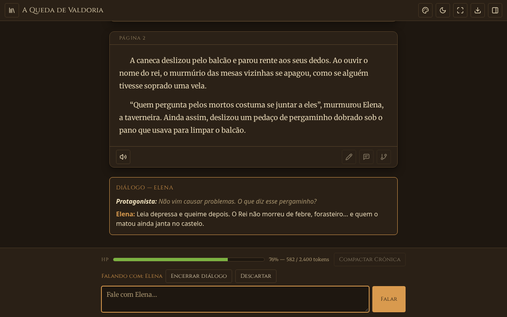
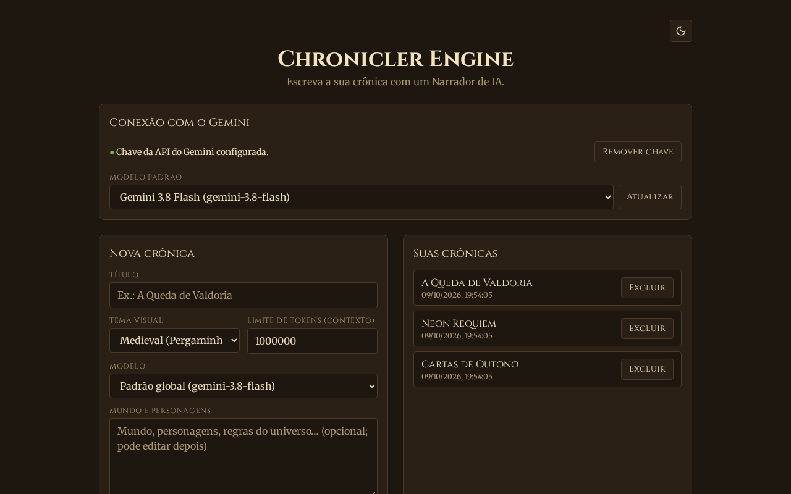
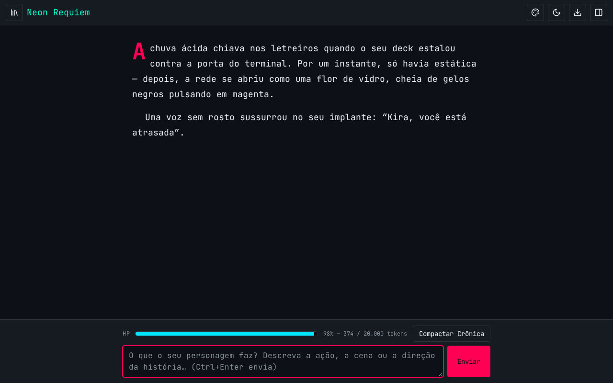
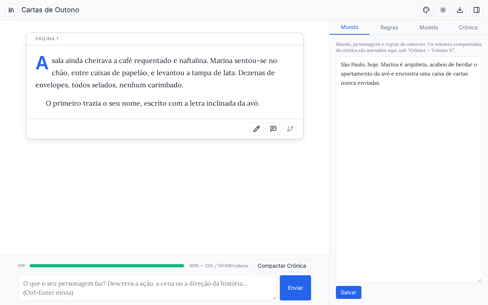
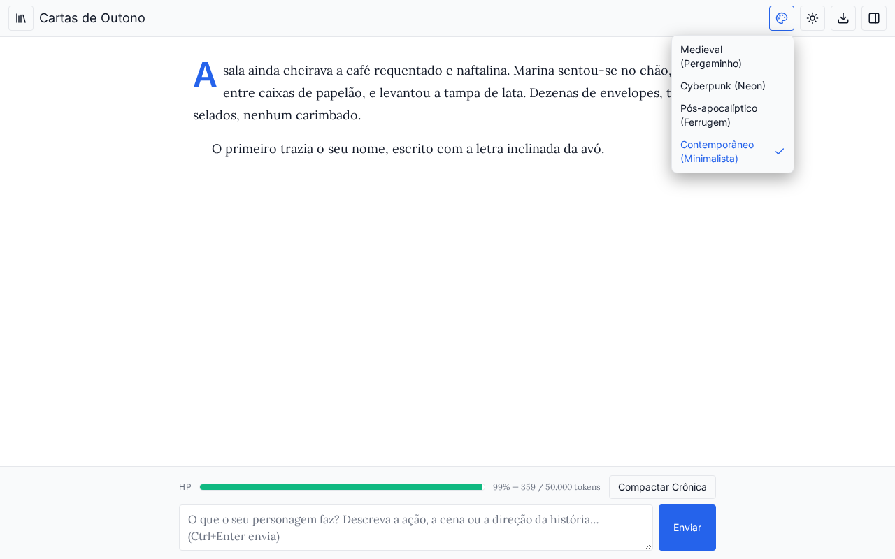
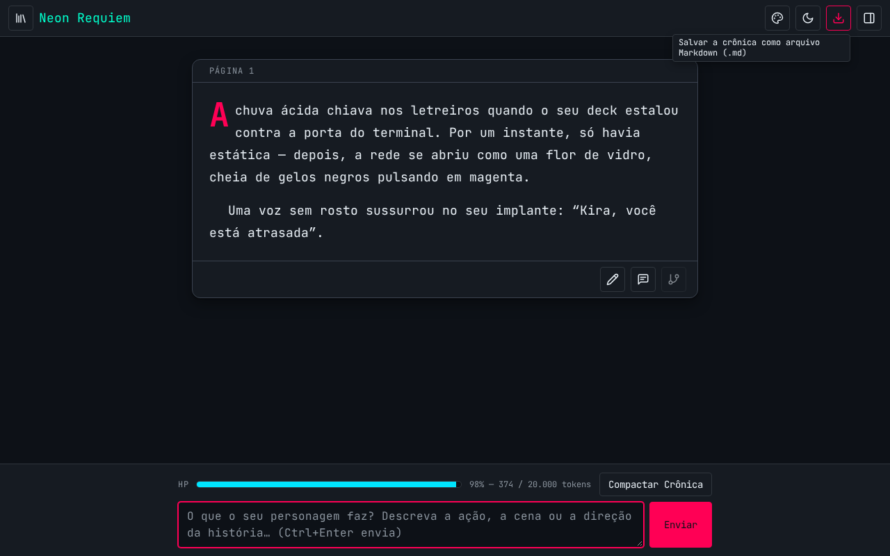
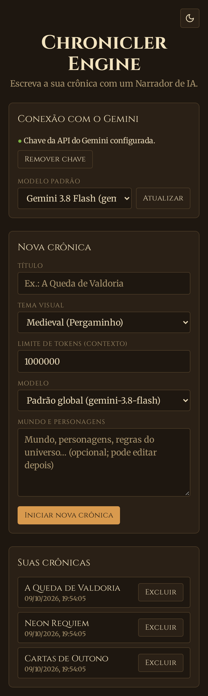
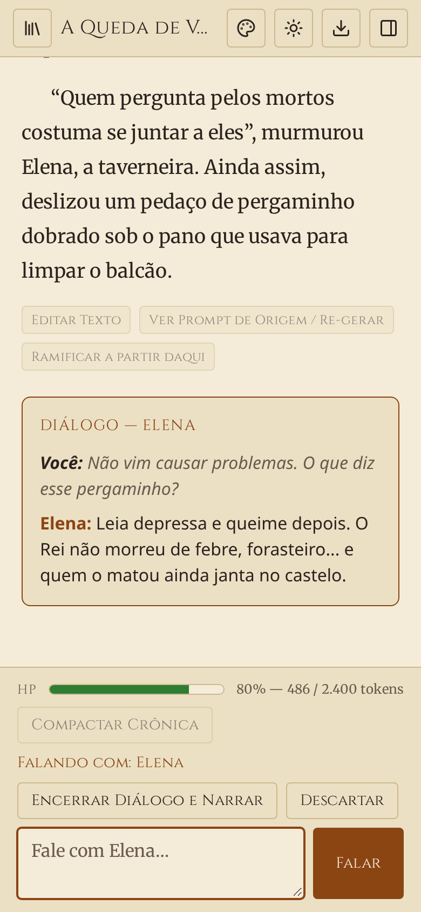
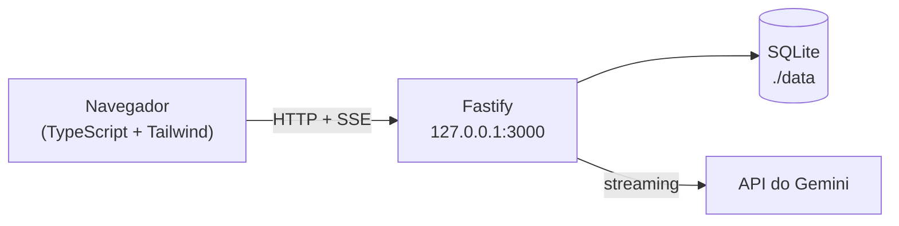

# Chronicler Engine

> [!IMPORTANT]
> **Projeto 100% gerado por IA.** Todo o código, testes, documentação e configuração deste repositório foram produzidos por um agente de IA no **Antigravity**, usando o modelo **Claude Sonnet 5.5 com *thinking* no nível High** (informação fornecida pelo autor do projeto). O papel humano foi o de definir o design document, aprovar as decisões de implementação e revisar o andamento. Trate o código como qualquer código gerado por IA: revise antes de usar em produção.

Plataforma de escrita e RPG narrativo colaborativo: você conduz a história e o Gemini atua como **Narrador**, escrevendo a prosa em um *Tome* contínuo (sem balões de chat). Tudo roda localmente, com SQLite — só a geração de texto sai da sua máquina, rumo à API do Gemini.

> Especificação completa e decisões de implementação: [`chronicler_engine_design_document.md`](chronicler_engine_design_document.md) (a seção 11 prevalece em caso de conflito). Andamento: [`TASKS.md`](TASKS.md).

<p align="center">
  
</p>

## Sumário

- [Recursos](#recursos)
- [Requisitos](#requisitos)
- [Subindo com Docker](#subindo-com-docker)
- [Subindo com Podman](#subindo-com-podman)
- [Primeiro uso](#primeiro-uso)
- [Atualizar, parar e fazer backup](#atualizar-parar-e-fazer-backup)
- [Solução de problemas](#solução-de-problemas)
- [Capturas de tela](#capturas-de-tela)
- [Como funciona](#como-funciona)
- [Desenvolvimento local](#desenvolvimento-local)
- [Licença](#licença)
- [Sobre a autoria](#sobre-a-autoria)

## Recursos

- **Tome interativo** com streaming da narrativa, edição direta, re-geração a partir do prompt de origem (descartando os blocos posteriores, com aviso) e ramificação a partir de qualquer bloco.
- **Modo Diálogo**: o Narrador pode abrir uma conversa com um NPC (persona isolada, que não conhece o resto da história). Quem encerra é você (`Encerrar Diálogo e Narrar`, que costura a cena em prosa, ou `Descartar`); o NPC apenas *sinaliza* que quer terminar, destacando o botão. Recarregar a página retoma a cena.
- **HP do Narrador**: barra de contexto (tokens usados × limite configurável por sessão) e **Compactação de Crônica**, que gera uma sinopse revisável por você antes de arquivar os blocos antigos.
- **4 temas**, cada um em variação clara e escura (Medieval, Cyberpunk, Pós-apocalíptico, Contemporâneo), com fontes empacotadas localmente (nenhum CDN). O modo segue o sistema por padrão.
- **Salvar em Markdown** (`.md`): baixa a crônica inteira, inclusive os capítulos já compactados, com a opção de incluir mundo e sinopses. Seus prompts nunca vão no arquivo.
- **Seletor de modelos** alimentado pela própria API do Gemini (só modelos de geração de texto), com padrão global e escolha por sessão.
- Interface em pt-BR, responsiva (funciona no celular) e acessível por teclado (botões de ícone com tooltip e `aria-label`).

## Requisitos

| O que | Para quê |
| --- | --- |
| **Docker** com Compose v2 **ou** **Podman** (+ `podman-compose`) | Subir o contêiner (não é preciso instalar Node na máquina) |
| **Chave da API do Gemini** | Gerar texto. Crie uma em [Google AI Studio](https://aistudio.google.com/apikey); ela é informada pela interface, não por arquivo |
| ~300 MB de disco e acesso à internet no *build* | Baixar a imagem `node:22-alpine` e as dependências |

Em qualquer máquina com Linux, macOS ou Windows (WSL2) que rode contêineres, o fluxo é o mesmo.

## Subindo com Docker

```bash
git clone <url-deste-repositório> chronicler-engine
cd chronicler-engine
docker compose up -d --build
```

Abra <http://localhost:3000>. Pronto: o contêiner reinicia sozinho (`restart: unless-stopped`) e os dados ficam em `./data`. O primeiro *build* leva ~2 minutos (baixa a imagem base e compila as dependências); os seguintes usam cache.

> [!NOTE]
> Se o Docker acusar `permission denied ... docker.sock`, o seu usuário não está no grupo `docker`: rode `sudo usermod -aG docker $USER` e abra uma nova sessão (ou use `newgrp docker`). Se disser que não consegue conectar à API, o serviço está parado: `sudo systemctl enable --now docker`.

Validado com Docker 29 + Compose 5 (Fedora 44): *build*, subida com o volume criado pelo próprio Docker (o *entrypoint* acerta a posse e o servidor roda **sem root**), `healthcheck` *healthy*, dados persistindo após `restart` e parada em < 1 s.

## Subindo com Podman

Rootless (sem `sudo`), inclusive em Fedora/RHEL com SELinux. Há duas formas equivalentes.

**A) Com `podman-compose`** (instale com `pip install --user podman-compose` ou `sudo dnf install podman-compose`):

```bash
git clone <url-deste-repositório> chronicler-engine
cd chronicler-engine
mkdir -p data
podman-compose -f docker-compose.yml -f docker-compose.podman.yml up -d --build
```

**B) Só com `podman`** (sem compose):

```bash
podman build -t chronicler-engine .
mkdir -p data
podman run -d --name chronicler-engine --restart unless-stopped \
  --userns=keep-id --user "$(id -u):$(id -g)" \
  -p 127.0.0.1:3000:3000 \
  -v ./data:/data:Z \
  chronicler-engine
```

Abra <http://localhost:3000>.

Por que o `docker-compose.podman.yml` e esses parâmetros? Em modo rootless, o "root" do contêiner é o seu usuário. Com `--userns=keep-id` + `--user`, os arquivos de `./data` continuam pertencendo a você; o sufixo `:Z` do volume ajusta o rótulo SELinux (inofensivo onde não há SELinux). O `HEALTHCHECK` do Dockerfile é ignorado no formato OCI do Podman (só aparece um aviso no *build*).

## Primeiro uso

1. **Informe a chave do Gemini** em *Conexão com o Gemini* e clique em *Validar e salvar*. A chave é testada na hora, gravada **apenas** no SQLite local e nunca devolvida ao navegador.
2. Escolha o **modelo padrão** na lista (ela é consultada na API; *Atualizar* consulta de novo). O padrão inicial é `gemini-3.8-flash`.
3. Em **Nova crônica**, dê um título, escolha o tema visual, o limite de tokens do contexto (padrão: 1.000.000) e, se quiser, descreva o mundo e os personagens.
4. No Tome, descreva o que o seu personagem faz e envie com `Enviar` ou `Ctrl+Enter`. O Narrador responde em prosa, em tempo real.
5. Use o painel **Contexto** (ícone à direita no cabeçalho) para editar mundo/personagens e ver os volumes compactados, **Salvar em Markdown** para exportar, e acompanhe o **HP** na barra inferior: perto de zero, o botão *Compactar Crônica* pulsa.

> [!WARNING]
> A interface **não tem autenticação** e o banco guarda a chave da API. Por isso a porta é publicada somente em `127.0.0.1`. Para acessar de outra máquina, ponha um proxy reverso com autenticação (ou uma VPN) na frente — não troque o bind para `0.0.0.0` sozinho.

## Atualizar, parar e fazer backup

| Tarefa | Docker | Podman (compose) |
| --- | --- | --- |
| Atualizar após `git pull` | `docker compose up -d --build` | `podman-compose -f docker-compose.yml -f docker-compose.podman.yml up -d --build --force-recreate` |
| Ver logs | `docker compose logs -f` | `podman logs -f chronicler-engine` |
| Parar (dados ficam) | `docker compose down` | `podman-compose -f docker-compose.yml -f docker-compose.podman.yml down` |

> [!TIP]
> No Podman, `up -d --build` sozinho **reconstrói a imagem mas pode manter o contêiner antigo** em execução. Use `--force-recreate` (ou `down` antes) para garantir a versão nova e faça um *hard refresh* no navegador (`Ctrl+Shift+R`).

- **Backup:** todos os dados (SQLite + chave) estão na pasta `./data`. Pare o contêiner e copie a pasta (`cp -a data data.bak`).
- **Recomeçar do zero:** pare o contêiner e apague `./data`.
- **Outra porta:** mude `127.0.0.1:3000:3000` no `docker-compose.yml` (ex.: `127.0.0.1:8080:3000`).

## Solução de problemas

| Sintoma | Causa provável / solução |
| --- | --- |
| `port is already allocated` / `address already in use` | A porta 3000 está ocupada (ou um contêiner antigo ainda a segura). Use `docker ps` / `podman ps -a`, remova o antigo ou mude a porta. |
| Podman: *name already in use* ou o *pod* "quebra" por causa de outro contêiner | Remova o remanescente: `podman rm -f chronicler-engine` e suba de novo. |
| `attempt to write a readonly database` / `EACCES` em `./data` | Permissão do volume. No Podman use o `docker-compose.podman.yml` (ou `--userns=keep-id --user …`); com UID diferente de 1000, ajuste `user:` no arquivo. No Docker o *entrypoint* corrige a posse sozinho. |
| Lista de modelos vazia / "Não foi possível consultar" | Chave inválida, sem internet no contêiner ou cota esgotada. Clique em *Atualizar* depois de resolver. |
| Atualizei mas a interface não mudou | Veja a dica de `--force-recreate` acima e o *hard refresh*. |
| `permission denied` em `/var/run/docker.sock` | Usuário fora do grupo `docker`: `sudo usermod -aG docker $USER` e nova sessão de login. |
| `docker compose` não existe | Instale o plugin Compose v2 (ou use `docker-compose`), ou siga o caminho Podman (B), que não precisa de compose. |

## Capturas de tela

As imagens abaixo são geradas por script (veja [Desenvolvimento local](#desenvolvimento-local)) com um Gemini simulado e uma história de exemplo — nenhuma chave real é usada.

| | |
| --- | --- |
|  |  |
| **Biblioteca**: chave, modelo padrão, nova crônica e lista | **Cyberpunk (escuro)** com a barra de HP |
|  |  |
| **Contemporâneo (claro)** com o painel de Contexto aberto | **Menu de tema** (o de modo claro/escuro funciona igual) |
|  | |
| **Tooltips** em todos os botões de ícone | |

**No celular** (sem rolagem horizontal):

<p>
  
  &nbsp;
  
</p>

## Como funciona



- **Backend:** Fastify + `better-sqlite3`; o Narrador responde em JSON estruturado (`narrative_text` + gatilho opcional de diálogo), e o texto é enviado ao navegador em tempo real por SSE.
- **Frontend:** TypeScript puro + Tailwind (sem framework), empacotado com esbuild e servido pelo próprio Fastify (`@fastify/static`).
- **Contexto do Narrador:** mundo e sinopses compactadas como instrução de sistema + o corpus de blocos ativos; só o texto gerado e as suas instruções entram, nunca metadados.
- **Imagem de contêiner:** *build* multi-stage (Node 22 Alpine); o runtime leva apenas dependências de produção, sem toolchain.

Detalhes, modelo de dados e API: [design document](chronicler_engine_design_document.md).

## Desenvolvimento local

Requer **Node.js ≥ 22**.

```bash
npm install
npm run build:client   # gera public/assets (app.js e app.css)
npm run dev            # servidor com recarga em http://127.0.0.1:3000
```

| Comando | O que faz |
| --- | --- |
| `npm test` | Suíte de testes (Vitest; Gemini mockado, UI em jsdom) |
| `npm run typecheck` / `npm run typecheck:client` | Verificação de tipos do servidor / do cliente |
| `npm run build` | Compila o servidor (`dist/`) e o cliente (`public/assets/`) |
| `npm start` | Executa o build de produção |
| `npm run fonts` | Reempacota as fontes de `@fontsource/*` em `public/fonts/` |
| `npm run screenshots` | Regenera `docs/screenshots/` com um Chromium headless (Gemini simulado; use `CHROME_PATH=…` se não houver um navegador do Playwright) |

### Variáveis de ambiente

| Variável | Padrão | Descrição |
| --- | --- | --- |
| `PORT` | `3000` | Porta HTTP |
| `HOST` | `127.0.0.1` (`0.0.0.0` no container) | Interface de escuta |
| `DATABASE_PATH` | `./data/chronicler.db` (`/data/chronicler.db` no container) | Arquivo SQLite |
| `PUBLIC_DIR` | `./public` | Diretório do frontend estático |

A chave da API é configurada pela interface (e gravada no banco local). O arquivo `GEMINIKEY.txt`, usado apenas pelos scripts de verificação em `scripts/live-*.ts`, está no `.gitignore`.

## Licença

Distribuído sob a licença **MIT**. Consulte o arquivo [`LICENSE`](LICENSE) para mais detalhes (isenção total de garantia e responsabilidade).

## Sobre a autoria

Este projeto foi construído por IA de ponta a ponta, em sessões do **Antigravity** com o modelo **Claude Sonnet 5.5 (thinking: High)**, seguindo o [design document](chronicler_engine_design_document.md). O histórico de commits (um por fase) e o [`TASKS.md`](TASKS.md) registram o processo; as decisões tomadas durante a implementação estão na seção 11 do design document. Limitações conhecidas estão listadas ao final do `TASKS.md`.
