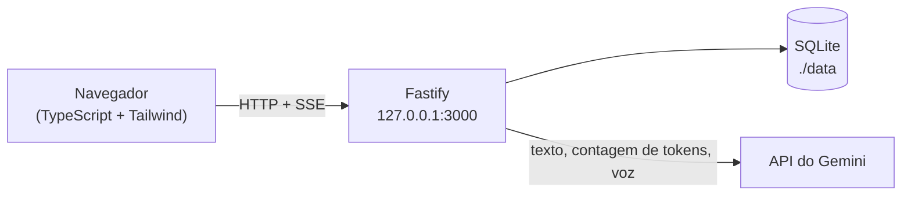

# Arquitetura

Visão geral do Chronicler Engine: o que é, os princípios que não se negociam, como as peças se encaixam e como uma geração percorre o sistema. Os detalhes de cada área estão nos documentos vizinhos (veja o [índice no README](../README.md#documentação)).

## Visão geral

O Chronicler Engine é uma plataforma web de escrita e RPG narrativo colaborativo: o usuário é o **Diretor/Coautor** e o Gemini é o **Narrador**. O jogador define ações e rumos; a IA os expande em prosa literária, **sem nunca avançar a trama além da intenção expressa**. O texto aparece num *Tome* (sem balões de chat), em que cada instrução do jogador gera uma **página**.

Tudo roda localmente, para um único usuário, em um contêiner. Só o texto (e a voz) saem da máquina, rumo à API do Gemini.

## Princípios

1. **Soberania do autor.** A IA é uma ferramenta de prosa: não decide o destino dos personagens se não for instruída a fazê-lo.
2. **Contexto sem ruído (corpus limpo).** As meta-instruções do jogador (*"deixe mais sombrio"*) servem só para gerar a página da vez e **nunca** voltam ao histórico enviado à IA. O corpus é prosa literária pura ([Narrador](narrador.md#isolamento-das-meta-instruções)).
3. **Curadoria e plasticidade.** Todo texto, contexto e regra é editável. Reeditar o passado por IA descarta o futuro, criando uma nova linha do tempo contínua; editar o texto "na unha" preserva as páginas seguintes.
4. **Visibilidade de recursos.** O consumo da janela de contexto aparece como uma barra de vida (*HP do Narrador*), com um fluxo de compactação editorial assistida.
5. **Autonomia local.** Servidor próprio, sem login, persistência em SQLite num volume.
6. **Nada de gasto escondido.** Gerar voz custa tokens: toda geração de áudio é pedida (ou ligada) pelo usuário, e a reprodução contínua **sempre** confirma o custo antes de gerar ([Narração por voz](narracao-por-voz.md)).

## Stack

| Camada | Escolha |
| --- | --- |
| Servidor | Node.js ≥ 22 (ESM, TypeScript), Fastify, `better-sqlite3` (síncrono) |
| IA | SDK `@google/genai` (texto estruturado, contagem de tokens, TTS pela Interactions API) |
| Cliente | TypeScript puro, **sem framework**; Tailwind CSS 3; empacotado com esbuild |
| Fontes e ícones | Fontes locais (`@fontsource`, subconjunto latino em `woff2`); ícones SVG inline. **Nenhum CDN** |
| Testes | Vitest (Gemini simulado, UI em jsdom contra o servidor real) e verificações visuais com Chromium/Firefox headless via `playwright-core` |
| Entrega | Imagem de contêiner única (Node 22 Alpine, multi-stage), publicada no GHCR em *push* para `main` ou tags `v*.*.*` após passar pelo job de verificação (`typecheck:all`, `npm test`, `check:docs`) no CI ([Desenvolvimento](desenvolvimento.md#integração-contínua-ci)) |

A interface é **fixa em pt-BR**. O modelo padrão do Narrador é `gemini-3.8-flash`; o app consulta `models.list` e oferece os modelos de texto disponíveis.

## Estrutura do código

| Pasta | Conteúdo |
| --- | --- |
| [`src/`](../src) | Servidor: `server.ts` (Fastify, `setErrorHandler` — converte `HttpError` e `MissingApiKeyError` → `409 missing_api_key` —, `SIGTERM`/`SIGINT` e handlers de `unhandledRejection`/`uncaughtException`), `context.ts` (`AppContext`, `HttpError`), `config.ts` (`loadConfig` com validação `positiveInt` e fallback para o padrão), `export.ts` (Markdown) |
| [`src/routes/`](../src/routes) | Rotas REST/SSE por área (`sessions`, `narrative`, `dialogue`, `compaction`, `tokens`, `archives`, `audio`, `settings`); `common.ts` (schemas e guardas compartilhados: `idParams`, `requireSession`, `requirePage`, `assertNoActiveDialogue`, `assertNotArchived`, `assertNotBusy`), `turnRunner.ts` (travas em memória e execução SSE), `sse.ts` (`openSse`) |
| [`src/ai/`](../src/ai) | Gateway do Gemini (`gateway.ts`, com timeout `GENERATION_IDLE_TIMEOUT_MS` = 180 s por padrão, `COMPACTION_IDLE_TIMEOUT_MS` = 300 s na compactação e `SYNTHESIS_TIMEOUT_MS` = 300 s em `synthesize`), construção do contexto (`contextBuilder.ts`), Narrador e streaming (`narrator.ts`, `narratorSchema.ts`, `narrativeStream.ts`), diálogo (`dialogue.ts`, `dialogueProse.ts`), compactação (`compaction.ts`), HP (`tokens.ts`), lista de modelos (`models.ts`) |
| [`src/db/`](../src/db) | `connection.ts` (abertura, pragmas WAL/`auto_vacuum` e *runner* de migrações com backup `.bak`), [`schema.ts` e `migrations.ts`](modelo-de-dados.md), `types.ts`, `index.ts` (`createRepositories`, `repos.transaction`), `repositories/` por tabela (`sessions`, `pages`, `dialogues`, `archives`, `audio`, `settings`) |
| [`src/tts/`](../src/tts) | Narração por voz: `service.ts` (`AudioService`, fila de jobs), `rateLimiter.ts` (janela deslizante RPM), `config.ts` (vozes e modelos), `text.ts` (`cleanForSpeech`, `splitForSpeech`), `pcm.ts` (WAV), `mp3.ts` (`@breezystack/lamejs`) |
| [`src/prompts/`](../src/prompts) | Regras padrão do Narrador (`defaultSystemRules.ts`) |
| [`client/`](../client) | Cliente: roteador (`main.ts`), cliente HTTP (`api.ts`), SSE (`sse.ts`), temas (`theme.ts`), utilitários (`dom.ts`, `download.ts`, `viewport.ts`, `icons.ts`), áudio (`audioPlayer.ts`, `audioUi.ts`, `playerBar.ts`, `continuousPlayback.ts`, `continuousUi.ts`), telas em `views/` (`home.ts`, `session.ts`) e componentes em `components/` (`pageCard`, `controls`, `drawer`, `dialogueModal`, `compactionModal`, `archiveReaderModal`, `confirmModal`) |
| [`scripts/`](../scripts) | Build do cliente (`build-client.mjs`), fontes, ícones, logo, capturas, `check-docs.ts`, verificações visuais (`check-*`) e testes manuais contra a API real (`live-*`) |
| [`test/`](../test) | Suíte Vitest, utilitários de teste em `helpers.ts` (`makeApp`, `withKey`, `FakeGateway`) e fixture de migração em `fixtures/schemaV3.ts` |

## Ciclo de uma geração

1. O cliente envia `POST /api/sessions/:id/narrative/next` com o `player_instruction`.
2. A rota confere `assertNoActiveDialogue` (`409` se houver diálogo ativo) e o `TurnRunner.withClaim(session.id, ...)` adquire a **trava da sessão** (`409` se já houver geração em curso), garantindo sua liberação em bloco `finally` mesmo diante de falhas na montagem do payload ou antes da abertura do SSE.
3. O `contextBuilder` monta o payload: regras como `systemInstruction`; um único turno de usuário com *Contexto do Mundo*, *Corpus Narrativo* (só o `generated_text` das páginas ativas) e a *Ação do Jogador*.
4. O Gemini responde em **JSON estruturado** (`narrative_text` + `dialogue_trigger`). `GeminiGatewayImpl.streamGenerate` monitora inatividade (`GENERATION_IDLE_TIMEOUT_MS` = 180 s, contados desde antes de `generateContentStream` — cobrindo tanto o tempo até o 1º fragmento quanto intervalos entre fragmentos — e abortando como `GenerationError`). O servidor faz *parse* incremental do JSON e repassa os trechos de `narrative_text` ao cliente por SSE, em tempo real.
5. Só no fechamento do payload a página é gravada (e o `dialogue_trigger`, se houver, abre um diálogo). **Se algo falhar no meio — JSON inválido, timeout, erro da API, cliente desconectado — nada é gravado.**
6. O cliente recarrega a sessão do servidor (fonte única da verdade) e recalcula o HP.

### Eventos SSE

Usados por `narrative/next`, `regenerate`, `dialogue/:id/conclude` e `narrate-dialogue`:

| Evento | Dados | Quando |
| --- | --- | --- |
| `start` | `{ model }` | Início da geração |
| `chunk` | `{ text }` | Trecho novo de `narrative_text` |
| `status` | `{ phase, message, ... }` | Progresso das etapas intermediárias (ex.: gerando o cérebro de cada NPC do diálogo ou transformando falas em prosa) |
| `retry` | `{ attempt, of }` | (diálogo) a tentativa foi rejeitada pela verificação de fidelidade; limpe o texto parcial |
| `page` | `{ page, discarded }` (+ `narration` no diálogo) | Página gravada, depois de persistir |
| `dialogue_trigger` | `{ dialogue_id, npc_name }` | Só no fechamento, depois de persistir; o cliente carrega o diálogo ativo e seus participantes em seguida |
| `error` | `{ message }` | Falha durante o stream |
| `done` | — | Fim |

Erros **antes** do início do stream voltam como JSON com status HTTP normal (por exemplo `409 missing_api_key`).

### Concorrência e timeouts

O `TurnRunner` mantém um `Set<string>` em memória para serializar operações concorrentes (`409 Conflict`):

- **Chave da sessão (`session.id`):** adquirida com `turns.withClaim(session.id, ...)` por `narrative/next`, `regenerate`, `narrate-dialogue`, `dialogue/:id/conclude`, `compact/preview` e `compact/commit`. Rotas mutantes síncronas que não podem coexistir com uma geração em andamento (`PUT /narrative/pages/:id`, `branch`, `redo-dialogue` e `dialogue/:id/cancel`) apenas consultam a trava via `assertNotBusy(turns, session.id)`. Além disso, `assertNoActiveDialogue` bloqueia (`409`) narrar, regenerar, editar, ramificar, refazer/reprocessar diálogo e compactar enquanto existir um diálogo `active` na sessão. Rotas de leitura, `PUT /sessions/:id/context`, `DELETE /sessions/:id` e jobs de áudio em segundo plano não disputam a trava de turno.
- **Chave do diálogo (`d:<dialogue.id>`):** adquirida com `turns.withClaim('d:' + dialogue.id, ...)` em `POST /api/dialogue/:id/message` (e consultada em `conclude` e `cancel`) para impedir falas simultâneas na mesma conversa com o NPC.
- **Timeouts na API do Gemini:** todo chamador de `streamGenerate` está sujeito a timeout de inatividade: **180 s** (`GENERATION_IDLE_TIMEOUT_MS`) para turnos normais (narrativa, regeneração, conclusão/reprocessamento de diálogo e fala de NPC em `/dialogue/:id/message`) e **300 s** (`COMPACTION_IDLE_TIMEOUT_MS`) para a minuta de compactação em `/compact/preview` (que pode processar centenas de milhares de tokens de entrada antes do 1º fragmento). A síntese de voz (`synthesize`) tem timeout de **300 s** (`SYNTHESIS_TIMEOUT_MS`). Chamadas rápidas de metadados (`countTokens` e `listModels`) não aplicam timer próprio.

## Segurança e privacidade

- **Sem autenticação.** O compose publica a porta só em loopback (`127.0.0.1:3000:3000`). Para acessar de fora, use um proxy reverso com autenticação ou uma VPN; não troque o *bind* para `0.0.0.0` sozinho.
- A **chave da API** fica em texto plano no SQLite local (uso pessoal), é validada (`models.list`) antes de gravar e **nunca** é devolvida por nenhum endpoint.
- `data/`, `*.db*` e `GEMINIKEY.txt` são ignorados pelo git e pelo `.dockerignore` (a chave e o banco nunca entram na imagem).
- Campos desconhecidos em corpos de requisição geram `400` (o Ajv não descarta em silêncio).
- O texto das páginas (e o texto lido pela voz) é enviado ao Google; o áudio é cobrado como tokens de saída da chave do usuário.

## Empacotamento (Docker)

[`Dockerfile`](../Dockerfile) com quatro estágios:

| Estágio | Papel |
| --- | --- |
| `base` | Alpine + `python3 make g++` (só para o *fallback* de compilação) |
| `deps` | `npm ci --omit=dev --ignore-scripts`; valida o carregamento do `better-sqlite3` (que já traz binários `musl` pré-compilados) e só recompila do código-fonte se a validação falhar |
| `builder` | `npm ci --ignore-scripts` + `npm run build` (`tsc` + esbuild + Tailwind) |
| `runner` | Sem toolchain nem devDependencies: copia `node_modules` de produção, `dist/` e `public/` |

- **Node 22**, não 20: o `better-sqlite3` 13 exige Node ≥ 22 (`engines: ">=22"`).
- `HOST=0.0.0.0` dentro do contêiner (o padrão do app fora dele é `127.0.0.1`).
- [`docker-entrypoint.sh`](../docker-entrypoint.sh) usa `su-exec`: corrige a posse do volume `/data` (o Docker cria *bind mounts* como root) e roda o servidor como o usuário `node`. Só faz `chown`/`su-exec` quando roda como root, o que é o que permite o **Podman rootless** funcionar com `userns_mode: keep-id` ([`docker-compose.podman.yml`](../docker-compose.podman.yml)).
- `HEALTHCHECK` consulta `/api/health` (ignorado no formato OCI do Podman, que só mostra um aviso no *build*).
- **Encerramento gracioso:** como PID 1 do contêiner o Node ignoraria `SIGTERM`; o servidor trata `SIGTERM`/`SIGINT` com `app.close()` (limite de 3 s para conexões SSE abertas; se estourar o timeout, encerra com código `1`), então `stop`/`down` não esperam 10 s.
- O [`.dockerignore`](../.dockerignore) também exclui testes, `.git/`, `node_modules/` e `public/assets/` (recompilado no *build*).

Operação (subir, atualizar, backup): [Instalação e operação](instalacao-e-operacao.md).
