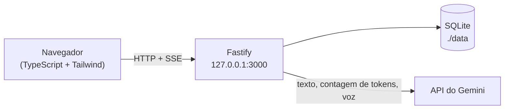

# Arquitetura

Visão geral do Chronicler Engine: o que é, os princípios que não se negociam, como as peças se encaixam e como uma geração percorre o sistema. Os detalhes de cada área estão nos documentos vizinhos (veja o [índice no README](../README.md#documentação)).

## Visão geral

O Chronicler Engine é uma plataforma web de escrita e RPG narrativo colaborativo: o usuário é o **Diretor/Coautor** e o Gemini é o **Narrador**. O jogador define ações e rumos; a IA os expande em prosa literária, **sem nunca avançar a trama além da intenção expressa**. O texto aparece num *Tome* (sem balões de chat), em que cada instrução do jogador gera uma **página**.

Tudo roda localmente, para um único usuário, em um contêiner. Só o texto (e a voz) saem da máquina, rumo à API do Gemini.

## Princípios

1. **Soberania do autor.** A IA é uma ferramenta de prosa: não decide o destino dos personagens se não for instruída a fazê-lo.
2. **Contexto sem ruído (corpus limpo).** As meta-instruções do jogador (*"deixe mais sombrio"*) servem só para gerar a página da vez e **nunca** voltam ao histórico enviado à IA. O corpus é prosa literária pura ([Narrador](narrador.md#isolamento-das-meta-instruções)).
3. **Curadoria e plasticidade.** Todo texto, contexto e regra é editável. Reeditar o passado por IA descarta o futuro, criando uma nova linha do tempo contínua; editar o texto "na unha" preserva as páginas seguintes.
4. **Visibilidade de recursos.** O consumo da janela de contexto aparece como uma barra de vida (*HP do Narrador*), com um fluxo de compactação editorial assistida.
5. **Autonomia local.** Servidor próprio, sem login, persistência em SQLite num volume.
6. **Nada de gasto escondido.** Gerar voz custa tokens: toda geração de áudio é pedida (ou ligada) pelo usuário, e a reprodução contínua **sempre** confirma o custo antes de gerar ([Narração por voz](narracao-por-voz.md)).

## Stack

| Camada | Escolha |
| --- | --- |
| Servidor | Node.js ≥ 22 (ESM, TypeScript), Fastify, `better-sqlite3` (síncrono) |
| IA | SDK `@google/genai` (texto estruturado, contagem de tokens, TTS pela Interactions API) |
| Cliente | TypeScript puro, **sem framework**; Tailwind CSS 3; empacotado com esbuild |
| Fontes e ícones | Fontes locais (`@fontsource`, subconjunto latino em `woff2`); ícones SVG inline. **Nenhum CDN** |
| Testes | Vitest (Gemini simulado, UI em jsdom contra o servidor real) e verificações visuais com Chromium/Firefox headless via `playwright-core` |
| Entrega | Imagem de contêiner única (Node 22 Alpine, multi-stage), publicada no GHCR a cada *push* em `main` |

A interface é **fixa em pt-BR**. O modelo padrão do Narrador é `gemini-3.8-flash`; o app consulta `models.list` e oferece os modelos de texto disponíveis.

## Estrutura do código

| Pasta | Conteúdo |
| --- | --- |
| [`src/`](../src) | Servidor: `server.ts` (monta o Fastify), `context.ts` (dependências compartilhadas), `config.ts`, `export.ts` (Markdown) |
| [`src/routes/`](../src/routes) | Rotas REST/SSE por área: `sessions`, `narrative`, `dialogue`, `compaction`, `tokens`, `archives`, `audio`, `settings`; `turnRunner.ts` (travas e SSE compartilhados) |
| [`src/ai/`](../src/ai) | Gateway do Gemini (`gateway.ts`), construção do contexto (`contextBuilder.ts`), Narrador e streaming (`narrator.ts`, `narrativeStream.ts`), diálogo (`dialogue.ts`, `dialogueProse.ts`), compactação, HP (`tokens.ts`), lista de modelos |
| [`src/db/`](../src/db) | Conexão, [schema e migrações](modelo-de-dados.md), repositórios por tabela |
| [`src/tts/`](../src/tts) | Narração por voz: limpeza e quebra de texto, PCM/WAV, MP3, `AudioService` (fila de jobs) |
| [`src/prompts/`](../src/prompts) | Regras padrão do Narrador |
| [`client/`](../client) | Cliente: roteador (`main.ts`), telas em `views/`, componentes (`pageCard`, `controls`, `audioUi`, `continuousUi`…), tema, SSE, ícones |
| [`scripts/`](../scripts) | Build do cliente, fontes, ícones, logo, capturas, verificações visuais (`check-*`) e testes manuais contra a API real (`live-*`) |
| [`test/`](../test) | Suíte Vitest |

## Ciclo de uma geração

1. O cliente envia `POST /api/sessions/:id/narrative/next` com o `player_instruction`.
2. O `TurnRunner` adquire a **trava da sessão** (uma geração por vez; `409` se houver outra ou um diálogo ativo).
3. O `contextBuilder` monta o payload: regras como `systemInstruction`; um único turno de usuário com *Contexto do Mundo*, *Corpus Narrativo* (só o `generated_text` das páginas ativas) e a *Ação do Jogador*.
4. O Gemini responde em **JSON estruturado** (`narrative_text` + `dialogue_trigger`). O servidor faz *parse* incremental do JSON e repassa os trechos de `narrative_text` ao cliente por SSE, em tempo real.
5. Só no fechamento do payload a página é gravada (e o `dialogue_trigger`, se houver, abre um diálogo). **Se algo falhar no meio — JSON inválido, erro da API, cliente desconectado — nada é gravado.**
6. O cliente recarrega a sessão do servidor (fonte única da verdade) e recalcula o HP.

### Eventos SSE

Usados por `narrative/next`, `regenerate`, `dialogue/:id/conclude` e `narrate-dialogue`:

| Evento | Dados | Quando |
| --- | --- | --- |
| `start` | `{ model }` | Início da geração |
| `chunk` | `{ text }` | Trecho novo de `narrative_text` |
| `retry` | `{ attempt, of }` | (diálogo) a tentativa foi rejeitada pela verificação de fidelidade; limpe o texto parcial |
| `page` | `{ page, discarded }` (+ `narration` no diálogo) | Página gravada, depois de persistir |
| `dialogue_trigger` | `{ dialogue_id, npc_name }` | Só no fechamento, depois de persistir; o `dynamic_system_prompt` nunca vai ao cliente |
| `error` | `{ message }` | Falha durante o stream |
| `done` | — | Fim |

Erros **antes** do início do stream voltam como JSON com status HTTP normal (por exemplo `409 missing_api_key`).

### Concorrência

Há **uma geração por sessão por vez**. Narrar, regenerar, ramificar, compactar e encerrar diálogo são recusados (`409`) enquanto houver diálogo ativo ou outra geração. Isso, junto com as transações descritas em [Narrador](narrador.md), garante que uma falha nunca apague dados.

## Segurança e privacidade

- **Sem autenticação.** O compose publica a porta só em loopback (`127.0.0.1:3000:3000`). Para acessar de fora, use um proxy reverso com autenticação ou uma VPN; não troque o *bind* para `0.0.0.0` sozinho.
- A **chave da API** fica em texto plano no SQLite local (uso pessoal), é validada (`models.list`) antes de gravar e **nunca** é devolvida por nenhum endpoint.
- `data/`, `*.db*` e `GEMINIKEY.txt` são ignorados pelo git e pelo `.dockerignore` (a chave e o banco nunca entram na imagem).
- Campos desconhecidos em corpos de requisição geram `400` (o Ajv não descarta em silêncio).
- O texto das páginas (e o texto lido pela voz) é enviado ao Google; o áudio é cobrado como tokens de saída da chave do usuário.

## Empacotamento (Docker)

[`Dockerfile`](../Dockerfile) com quatro estágios:

| Estágio | Papel |
| --- | --- |
| `base` | Alpine + `python3 make g++` (só para o *fallback* de compilação) |
| `deps` | `npm ci --omit=dev --ignore-scripts`; valida o carregamento do `better-sqlite3` (que já traz binários `musl` pré-compilados) e só recompila do código-fonte se a validação falhar |
| `builder` | `npm ci` + `npm run build` (`tsc` + esbuild + Tailwind) |
| `runner` | Sem toolchain nem devDependencies: copia `node_modules` de produção, `dist/` e `public/` |

- **Node 22**, não 20: o `better-sqlite3` 13 exige Node ≥ 22 (`engines: ">=22"`).
- `HOST=0.0.0.0` dentro do contêiner (o padrão do app fora dele é `127.0.0.1`).
- [`docker-entrypoint.sh`](../docker-entrypoint.sh) usa `su-exec`: corrige a posse do volume `/data` (o Docker cria *bind mounts* como root) e roda o servidor como o usuário `node`. Só faz `chown`/`su-exec` quando roda como root, o que é o que permite o **Podman rootless** funcionar com `userns_mode: keep-id` ([`docker-compose.podman.yml`](../docker-compose.podman.yml)).
- `HEALTHCHECK` consulta `/api/health` (ignorado no formato OCI do Podman, que só mostra um aviso no *build*).
- **Encerramento gracioso:** como PID 1 do contêiner o Node ignoraria `SIGTERM`; o servidor trata `SIGTERM`/`SIGINT` com `app.close()` (limite de 3 s para conexões SSE abertas), então `stop`/`down` não esperam 10 s.
- O [`.dockerignore`](../.dockerignore) também exclui testes, `.git/`, `node_modules/` e `public/assets/` (recompilado no *build*).

Operação (subir, atualizar, backup): [Instalação e operação](instalacao-e-operacao.md).
