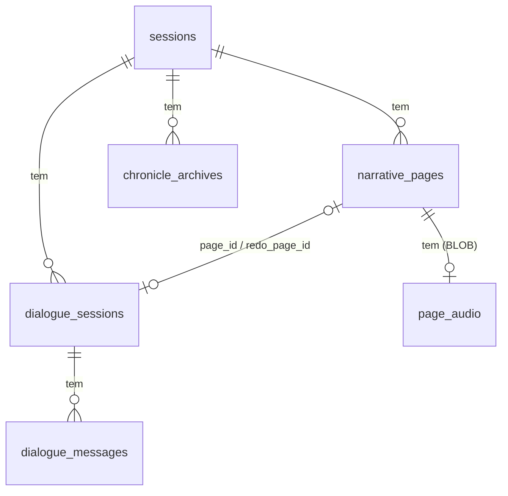

# Modelo de dados e migrações

O SQLite roda localmente (por padrão em `./data/chronicler.db`; `/data/chronicler.db` no contêiner) com o driver síncrono `better-sqlite3`. A fonte da verdade do schema é [`src/db/schema.ts`](../src/db/schema.ts) (`SCHEMA_VERSION = 6`); este documento explica o que cada parte significa.

## Tabelas

Todas as tabelas filhas usam `ON DELETE CASCADE`: excluir uma sessão apaga páginas, volumes, diálogos e áudios.

| Tabela | Papel |
| --- | --- |
| `app_settings` | Configurações globais em chave/valor: chave da API, modelo padrão, padrões de voz (`tts_*`) |
| `sessions` | Uma crônica: `title`, `system_rules`, `world_context`, `active_theme` (`medieval`, `cyberpunk`, `pos-apocaliptico`, `contemporaneo`), `token_limit` (1.000.000), `model` (`NULL` = padrão global), `tts_auto` (`NULL` = herda o padrão global; vale para páginas de prosa e de diálogo) |
| `narrative_pages` | As páginas do Tome (abaixo) |
| `chronicle_archives` | Um volume por compactação: `volume_number`, `summary_text` (a sinopse revisada) e a faixa `covered_page_start_index`…`covered_page_end_index`. `UNIQUE (session_id, volume_number)` |
| `dialogue_sessions` | Diálogos com NPC: `npc_name`, `player_name`, `dynamic_system_prompt` (**nunca exposto pela API**), `status` (`active`/`concluded`), `page_id` (a página em que virou), `redo_page_id` (página que um *Refazer* vai substituir) |
| `dialogue_messages` | Falas da conversa em andamento (`sender` `player`/`npc`). **Apagadas ao encerrar**: a página é a fonte da verdade |
| `page_audio` | O MP3 de cada página narrada (BLOB), em tabela separada para que listar páginas nunca carregue áudio |

### `narrative_pages`

| Coluna | Significado |
| --- | --- |
| `order_index` | Número da página (`Página N`). Absoluto: começa em 1 e **nunca é reaproveitado**, nem depois de compactar. `UNIQUE (session_id, order_index)` |
| `player_instruction` | O prompt que originou a página (auditoria e re-geração). Nunca vai ao corpus da IA nem à exportação. Em páginas de diálogo guarda a transcrição crua |
| `generated_text` | A prosa (original ou editada) |
| `model_identifier` | Modelo que gerou (`NULL` no *fallback* cru do diálogo) |
| `is_archived` | `1` depois de consumida por um volume: sai do contexto da IA, do HP e da próxima compactação, mas continua legível e exportável |
| `kind`, `npc_name` | `narrative` ou `dialogue`; nome do NPC nas páginas de diálogo |
| `raw_dialogue` | `1` = página de diálogo que ainda guarda a transcrição crua (antigas ou *fallback*); só essas ganham *Narrar diálogo* |

### `page_audio`

`page_id` (PK), `text_sha256` (hash do texto de quando o áudio foi gerado), `voice`, `model`, `style`, `mime`, `duration_ms`, `bytes`, `audio`. A leitura **confere o hash**: o áudio de um texto que já mudou é tratado como inexistente.

### Índices e invariantes impostos pelo banco

- `idx_pages_order` em `(session_id, order_index)`; `idx_dialogue_msgs` em `(dialogue_session_id, created_at)`.
- `idx_one_active_dialogue`: índice único parcial que impõe **no máximo um diálogo `active` por sessão**.
- `idx_dialogue_page`: índice único parcial em `page_id` (uma página de diálogo pertence a um só diálogo).

## `auto_vacuum` e o tamanho do arquivo

Áudios são grandes (≈ 360 KB por minuto). Para o arquivo do banco realmente **encolher** quando um áudio é descartado, o banco novo é criado com `auto_vacuum = INCREMENTAL` (definido em `openDatabase` antes do pragma WAL, só quando `user_version = 0`) e o `AudioRepository.reclaim()` roda `incremental_vacuum` fora de transações. Bancos criados antes dessa versão não têm essa propriedade.

## Migrações

O controle de versão usa `PRAGMA user_version`. Política do projeto (alpha): **bancos existentes são migrados**; só se quebra o banco (exigindo apagar `./data`) quando migrar for muito trabalhoso ou inflaria o programa com migrações demais. Quando isso acontecer, o README e a mensagem de erro dizem.

[`src/db/migrations.ts`](../src/db/migrations.ts):

- Cada migração roda numa **transação**, junto com a troca do `user_version`; se falhar, nada muda.
- Antes de migrar um banco em arquivo, o *runner* faz `wal_checkpoint(TRUNCATE)` e copia o arquivo para `<banco>.v<versão-antiga>.bak`.
- `MIN_MIGRATABLE_VERSION = 3`: bancos v1/v2 (de antes de `page_audio` e de `auto_vacuum`) e bancos de versão **mais nova** que a do programa são recusados na abertura, com mensagem explicando.
- `SCHEMA_SQL` descreve o schema de um banco **novo**; a ordem das colunas acrescentadas é a mesma dos `ALTER TABLE` das migrações, e [`test/migrations.test.ts`](../test/migrations.test.ts) confere que os dois caminhos geram o mesmo schema.

### Histórico de versões

| Versão | O que mudou | Migração |
| --- | --- | --- |
| 1 | Schema original (tabela `narrative_blocks`) | — |
| 2 | "Blocos" viraram "páginas" (`narrative_pages`, `covered_page_*`, rotas e JSON `pages`) | Recusada (apague `./data`) |
| 3 | Narração por voz: `page_audio`, `sessions.tts_auto`, `auto_vacuum` | Recusada se a origem for < 3 |
| 4 | Diálogo como página: `kind`, `npc_name`, `dialogue_sessions.player_name/page_id/redo_page_id`, `sessions.tts_auto_dialogue` (removida na v6) | v3 → v4: `ALTER TABLE`s; apaga diálogos já concluídos (não há página para ligá-los) |
| 5 | Diálogo narrado: `narrative_pages.raw_dialogue` | v4 → v5: marca como cruas (`1`) todas as páginas `kind = 'dialogue'` já existentes |
| 6 | Narração automática única: **remove** `sessions.tts_auto_dialogue` | v5 → v6: `DROP COLUMN` e apaga a configuração global `tts_auto_dialogue_default`; `tts_auto` e o padrão global passam a valer também para os diálogos |

### Como criar uma migração

1. Aumente `SCHEMA_VERSION` em `schema.ts` e atualize `SCHEMA_SQL`.
2. Acrescente `{ version, description, up }` em `MIGRATIONS`.
3. Rode `npm test`: `migrations.test.ts` compara o banco novo com o migrado.
4. Atualize a tabela acima e o aviso de [Instalação e operação](instalacao-e-operacao.md#atualizar-e-migrar-o-banco) se algo mudar para o usuário.
